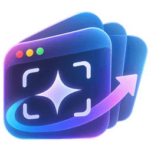

# UI Evolution Engine

**An autonomous interface-engineering agent that turns a screenshot into a compiled, running, native SwiftUI app — and then improves it — using Meta's models.**

Built for the **Meta Global AI Developer Hackathon** (theme: *Push the Frontier*).

A developer drops in a screenshot of an existing app or design, describes the transformation they want, and picks macOS or iOS. The engine then:

1. **Segments** the screenshot with **SAM 3.1** (pixel masks + boxes for buttons, cards, fields, icons, sidebars…).
2. **Understands** the interface with **Muse Spark** (regions, elements, colors, typography, spacing, hierarchy, relationships), grounded by SAM's measurements.
3. Writes a **validated design specification** and an **implementation plan** (Muse Spark, schema-constrained JSON, Zod-validated). Optionally generates original decorative artwork with **Muse Image**.
4. **Generates a multi-file SwiftUI project** (Muse Spark) — real Swift, not HTML.
5. **Compiles it with `xcodebuild`** in an isolated project. Compiler errors go back to Muse Spark, which repairs the code (up to 2 rounds).
6. **Launches it** in the iOS Simulator (or as a sandboxed macOS app) and **captures the real rendered screen**.
7. **Compares** the render with the reference and the request (Muse Spark, two images in, prioritized issue list out).
8. **Iterates** in one click: pick issues and/or type an instruction → a new version is generated, compiled, launched and reviewed again. Every version is preserved.

Nothing in the demo path is mocked. If the simulator or capture is unavailable, the UI says so instead of showing a fake preview.

## Demo

**[Watch the 3-minute demo (demo/UI-Evolution-Engine-demo.mp4)](demo/UI-Evolution-Engine-demo.mp4)**: one real run of this app, with real Meta model calls and real Xcode builds, nothing staged or mocked. Long waits are shown as a labeled time-lapse, and interaction scenes play slightly faster (1.25×).

> **Running it yourself:** this is a local tool for a **Mac with Xcode**, and it needs **your own Meta Model API key** (no key is included in this repository). Clone, `npm install`, `cp .env.example .env.local`, put your key in `MODEL_API_KEY`, `npm run dev`, open <http://localhost:3000>. The first-run checklist in the app tells you what is missing. Details in [Requirements](#requirements) and [Setup](#setup).

---

## Meta models used

| Model | ID | Where | Why |
|---|---|---|---|
| Muse Spark | `muse-spark-1.3` | Visual analysis, design spec + plan, SwiftUI generation, build-error repair, visual comparison, improvement | Multimodal reasoning + coding. Called through the **Responses API** with **streaming**, **reasoning summaries** (shown live in the UI) and **structured output** (`text.format` JSON Schema). |
| SAM 3.1 | `sam-3.1` | Optional first step | Concept prompts (`button`, `rectangle`, `card`, `text input field`, `icon`, `sidebar`, `title`), one per request, in parallel. Output parsed with Meta's official [`@meta-sam/parser`](https://www.npmjs.com/package/@meta-sam/parser); masks rendered as an overlay and the pixel boxes fed to Muse Spark as measurements. |
| Muse Image | `muse-image-1.0` | Optional step after the spec (toggle *Muse Image assets*) | Muse Spark may request up to two original decorative images (hero, background, empty-state art) in the spec; they are generated via `POST /v1/images/generations`, bundled as `Resources/<name>.png`, and shown through the harness helper `GeneratedAsset.image("name")`. Improvements reuse the parent version's assets. |

All calls go to `https://api.meta.ai/v1/responses` with `Authorization: Bearer $MODEL_API_KEY` from the Node.js server. The key never reaches the browser. Request formats follow the official docs at <https://dev.meta.ai/docs> (image input as base64 data URLs, `text.format` for structured output, `reasoning.effort`/`reasoning.summary`, SAM `metadata.include_confidence`). Retries use exponential backoff with jitter on 429/5xx, as the error-handling guide recommends.

---

## Requirements

It builds and runs real native apps, so it cannot run as a hosted web demo or on Linux/Windows.

- A **Mac**: the app calls `xcodebuild`, `xcrun simctl` and `screencapture` locally.
- macOS with **Xcode** (tested with Xcode 27.2, iOS 27.2 and macOS 27.2 SDKs) and at least one **iOS Simulator** device.
- **Node.js 20.17+** (tested with 23.6).
- A **Meta Model API key** of your own (<https://dev.meta.ai>). It goes in `.env.local`, which is git-ignored; never commit it.
- For exact macOS window capture: Screen Recording permission for the terminal that runs `npm run dev`. Without it the app falls back to an in-app render of its own window (vibrancy may look flat) and says so.

No Docker, no cloud GPUs, no paid build services.

## Setup

```bash
npm install
cp .env.example .env.local   # then put your key in MODEL_API_KEY
npm run dev                  # http://localhost:3000
```

Open <http://localhost:3000>. The welcome dialog checks the API key, Xcode and the simulator, and offers two one-click examples. If the key check is red, `MODEL_API_KEY` is missing from `.env.local` (restart `npm run dev` after editing it).

### Configuration (`.env.local`)

| Variable | Default | Purpose |
|---|---|---|
| `MODEL_API_KEY` | — (required) | Meta Model API key. Server-side only. |
| `META_API_BASE_URL` | `https://api.meta.ai/v1` | API base URL. |
| `UIEE_DATA_DIR` | `./data` | Projects, versions, generated sources, screenshots, logs. |
| `UIEE_DERIVED_DATA_DIR` | `./data/derived-data` | Xcode DerivedData (can be large; point it at another disk if needed). |
| `UIEE_IOS_SIMULATOR` | `iPhone 18 Pro` | Preferred simulator name or UDID (falls back to a booted/available iPhone). |
| `UIEE_BUILD_TIMEOUT_MS` | `420000` | Per-build timeout. |

### Scripts

```bash
npm run dev         # local app
npm run typecheck   # tsc --noEmit
npm run lint        # eslint
npm test            # vitest unit tests (policy, diagnostics parser, template, paths, schemas)
```

---

## Using it

On first launch a welcome screen explains the flow, checks your setup (API key, Xcode, simulator) and offers two bundled examples (`public/samples/`) that run end to end with one click. Reopen it any time with the **?** button; the sun/moon button switches between light, dark and system themes.

1. Drop / paste a PNG, JPEG or WebP screenshot (≤ 10 MB), or pick an example.
2. Choose **macOS app** or **iOS Simulator**, write the transformation request (two examples are one click away), optionally add constraints, keep SAM on, and optionally enable Muse Image assets.
3. **Start transformation.** The *Agent* tab shows each step, the model doing it, timing, and Muse Spark's streamed reasoning summary.
4. When it finishes, compare **Side by side** / **Before / After** / **SAM 3.1** overlay in the canvas; read the *Spec*, *Build* (attempts, diagnostics, AI repairs) and *Review* (score, prioritized issues).
5. Select issues and/or type an instruction → **Improve vN → new version**. Switch versions in *Iterations*; see which files changed in *SwiftUI source*. If a simulator hiccups, **Relaunch & capture again** re-runs only the preview and review for an existing build.
6. Take the result further: **Open in Xcode** opens the version's project on this Mac; **Download .zip** gives you the complete Xcode project (sources, Muse Image resources, `project.pbxproj`, a README) that builds on its own.

Each run is stored under `data/projects/<id>/versions/vN/` with the Xcode project (`xcode/`), the built `.app`, build logs, preview screenshot, and all structured model output in `project.json` (prompt, spec, plan, critique, model IDs, response IDs, token usage, timestamps).

---

## Architecture

```
Browser (Next.js / React / Tailwind / shadcn/ui)
  │  upload, poll project state (1.2 s while a job runs), view assets
  ▼
Next.js route handlers (Node.js runtime)
  ├─ /api/projects            create (multipart upload → Sharp validation) / list
  ├─ /api/projects/[id]       state (project.json)
  ├─ /api/projects/[id]/generate | improve | preview | cancel
  ├─ /api/projects/[id]/open      open a version in Xcode (`open -a Xcode <generated project>`)
  ├─ /api/projects/[id]/download  zip of a version's Xcode project
  ├─ /api/projects/[id]/assets/[...path]   screenshots, sources, logs (allowlisted, traversal-checked)
  └─ /api/status              API key present? Xcode version? simulator?
        │
        ▼
Job runner (src/lib/pipeline/runner.ts) — one job per project, progress persisted after every step
  segment ──► analyze ──► spec ──► assets ──► codegen ──► build ⇄ repair ──► preview ──► critique
  (SAM 3.1)   (Muse Spark)        (Muse Image) (Muse Spark)  (xcodebuild + Muse Spark) (simctl / screencapture) (Muse Spark)
        │
        ├─ src/lib/meta/client.ts   Responses API client: SSE streaming, retries, text.format
        ├─ src/lib/meta/sam.ts      SAM 3.1 concepts in parallel, @meta-sam/parser, overlay via Sharp
        ├─ src/lib/meta/image.ts    Muse Image generations for bundled decorative assets
        ├─ src/lib/schemas.ts       Zod schemas → JSON Schema for the model → validation
        ├─ src/lib/xcode/template.ts  fixed .xcodeproj (synchronized folder group) + fixed app harness
        ├─ src/lib/xcode/policy.ts    static policy for generated Swift
        ├─ src/lib/xcode/build.ts     isolated project, xcodebuild, diagnostics parser, artifact cleanup
        ├─ src/lib/xcode/preview.ts   simulator boot/install/launch/verify/screenshot; macOS window capture
        └─ src/lib/xcode/exec.ts      the only process launcher: fixed executable allowlist
```

### The generated project

- A fixed `GeneratedApp.xcodeproj` (objectVersion 77, **file-system-synchronized group**), so every `.swift` file Muse Spark writes is compiled without the model ever touching `project.pbxproj`.
- A fixed `GeneratedApp.swift` harness owns `@main`; the model must provide `struct RootView: View`. On macOS the harness reports its window number on stdout so the server can capture exactly that window with `screencapture -l`; if that is not permitted it renders its own window (`cacheDisplay`) and prints it as base64 — the app never writes files.
- Targets iOS 18+/macOS 15+, Swift 5 language mode, ad-hoc signing for local runs, **App Sandbox enabled on macOS**.

### Security and reliability

- `MODEL_API_KEY` is read only on the server (`server-only` modules); `/api/status` reports presence, never the value.
- **No AI-generated command is ever executed.** Only `/usr/bin/xcodebuild`, `/usr/bin/xcrun` (simctl), `/usr/sbin/screencapture` and `/usr/bin/open` (only as `open -a Xcode <generated project>`) are run, with argv arrays (no shell) and timeouts; the generated macOS binary is launched only from inside `data/projects` and killed after capture.
- **Static policy on generated Swift** before compiling: import allowlist per platform; no `@main`, processes, dynamic loading, file system, network, pasteboard (the simulator clipboard is shared with the Mac), persistent storage, or unsafe pointers. Violations are fed back to Muse Spark like compiler errors.
- Generated file names must be `UpperCamelCase.swift`, optionally inside `Views/`, `Components/`, `Models/`, `Theme/` or `Support/`; writes are confined to the version's project directory.
- Uploads: size limit, MIME + **decode** check with Sharp, pixel limit, EXIF orientation applied, metadata stripped.
- Asset serving: project-id regex, extension allowlist, `..`/absolute path rejection, realpath check against the project root.
- All model output is schema-constrained **and** Zod-validated (one automatic retry on validation failure).
- Versions are append-only; regenerate/improve always create a new version. Jobs interrupted by a server restart are marked as such.
- Xcode intermediates are deleted after each build (module cache kept for speed); the built `.app` is copied into the version folder.

---

## Limitations (honest list)

- A screenshot cannot reveal source code or exact constraints; layout, sizes and colors are inferred and approximate.
- The goal is a *transformation* (e.g. web dashboard → native iPhone app), so the result is compared against the request and the reference's content, not pixel-matched.
- Generated apps are static UI with sample data (no networking or persistence — deliberately blocked by policy).
- Build repair is capped at 2 rounds; complex Swift type-checking errors can still fail, and the UI then shows the diagnostics instead of a preview.
- iOS previews use one simulator at a time; `simctl launch` can hang on a busy simulator, so launch is bounded and the app process is verified with `launchctl` inside the simulator.
- macOS capture needs Screen Recording permission for exact results; otherwise the in-app fallback may render materials/vibrancy flat (this is reported in the UI).
- Muse Image assets are decorative only (no icons, text or UI); at most two per generation.
- Single-user local tool: no auth, no multi-tenant isolation.

---

## Hackathon compliance notes

- All project-specific code in this repository was written during the hackathon period (Oct 26 – Nov 4, 2026), scaffolded from `create-next-app` and `shadcn` CLI templates; see `package.json` for third-party dependencies and their licenses.

**Built during the hackathon (our work):**

- The whole pipeline in `src/lib/`: the Meta API client (Responses API streaming, structured output, retries), SAM 3.1 segmentation and overlay, Muse Image assets, the prompts and Zod schemas, and the job runner with version history.
- The Xcode layer in `src/lib/xcode/`: project template and harness, source policy, allowlisted process runner, build with AI repair, simulator and Mac preview and capture.
- The workspace UI in `src/components/workspace/`, onboarding and examples, theme toggle, Open in Xcode / Download .zip.
- The API routes in `src/app/api/`, the tests in `tests/`, the sample references in `public/samples/` and the logo.

**Not ours (used as is):** Next.js, React, Tailwind CSS, shadcn/ui components in `src/components/ui/`, Zod, Sharp, fflate, lucide icons, Meta's `@meta-sam/parser`, and Apple's Xcode toolchain.
- Meta models do the actual work: every analysis, spec, line of Swift, repair and review shown in the UI comes from a recorded Muse Spark / SAM 3.1 response (response IDs, model IDs and token usage are stored per version and shown in the *Agent* tab).
- Test/demo reference images are original renders made for this project.
- Before submitting, make the repository public and record the 3-minute demo (suggested script below).

### Suggested 3-minute demo

1. Open the workspace (status chips show Meta API, Xcode, simulator).
2. Drop a screenshot of a web app, choose **iOS Simulator**, pick the dark-theme example prompt, **Start**.
3. While it runs: point at SAM 3.1's region count and Muse Spark's live reasoning in the *Agent* tab.
4. Open *Spec* (tokens, typography, component tree) and *SwiftUI source* (multi-file project).
5. *Build* shows `BUILD SUCCEEDED` (or AI repairs); the canvas shows the real simulator screenshot next to the reference; toggle the **SAM 3.1** overlay and **Before / After**.
6. *Review*: score and prioritized issues → select two, add an instruction → **Improve**.
7. Show v2 compiled and rendered, the *Iterations* table, and the changed files.

## Project structure

```
src/app/                 Next.js app router (page + API route handlers)
src/components/workspace Workspace UI (panels, viewer, inspector, source/log/history)
src/components/ui        shadcn/ui primitives
src/lib/meta             Meta Model API client and SAM 3.1 integration
src/lib/pipeline         prompts, Muse Spark stages, job runner
src/lib/xcode            project template, policy, build, preview, process allowlist
src/lib/storage          file-based project/version store
tests/                   vitest unit tests
data/                    local workspace (git-ignored)
```
